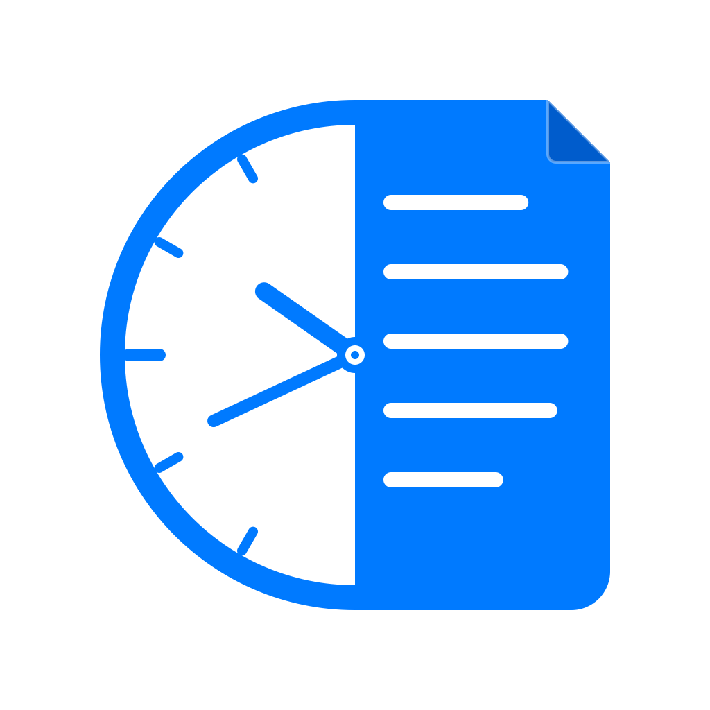
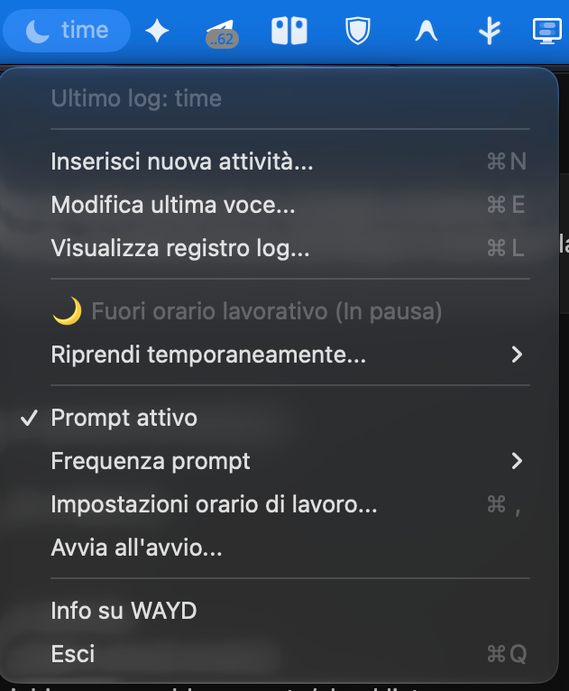
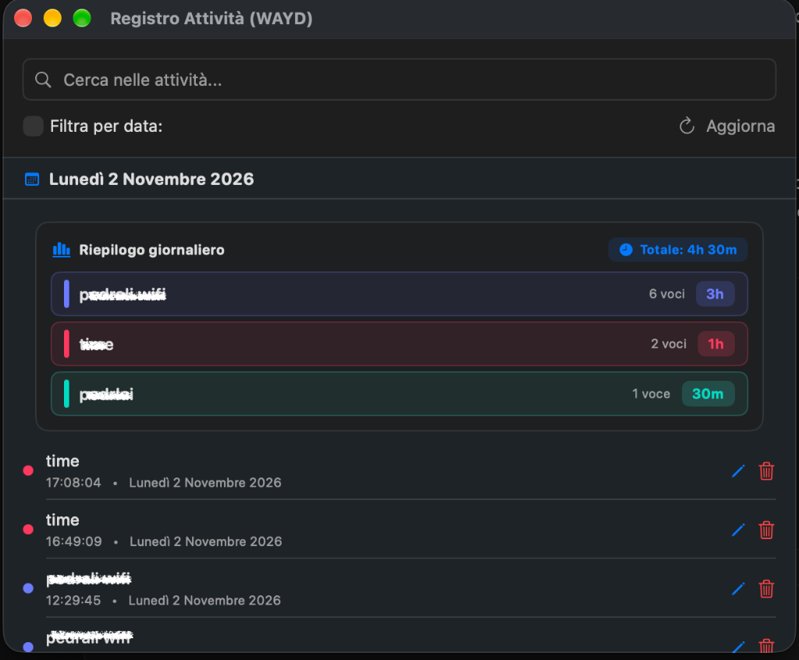

<p align="center">
  
</p>

# WAYD (What Are You Doing) - macOS

WAYD è un'applicazione nativa per macOS che vive nella barra dei menu e ti aiuta a monitorare la tua produttività chiedendoti periodicamente *"Cosa stai facendo?"*.

L'applicazione salva tutto lo storico delle tue risposte in un semplice file CSV locale in modo compatibile con gli standard di analisi dei dati.

---

## 📸 Schermate

<p align="center">
  
  &nbsp;&nbsp;&nbsp;&nbsp;
  
</p>

---

## 🌟 Funzionalità

* **Icona e Info nella Barra dei Menu**: Mostra l'icona di un orologio e l'ultimo log inserito direttamente nella barra in alto.
* **Prompt di Inserimento Nativo**: Una finestra popup SwiftUI pulita ed elegante che appare in primo piano per chiederti cosa stai facendo.
  * **Autocompletamento in linea (Type-Ahead)**: Man mano che scrivi nel campo, l'app autocompleta il testo suggerendo l'attività passata più rilevante ed evidenziando la parte completata.
  * **Navigazione da tastiera avanzata**: Scorri i suggerimenti visualizzati sotto il campo usando le frecce ⬆️/⬇️ con evidenziazione visiva azzurra. Premendo `Invio`, l'app auto-completa e salva direttamente il primo suggerimento (o quello correntemente selezionato).
* **Registro Log Completo con Riepilogo Giornaliero**:
  * **Riepilogo giornaliero a inizio giorno**: Box riassuntivo colorato con tempo totale della giornata e ripartizione per attività con badge grafici ed evidenziazione a colori.
  * Visualizzazione di tutta la cronologia raggruppata per data.
  * **Ricerca libera** (filtro testuale case-insensitive).
  * **Filtro per data ad intervallo**: Possibilità di filtrare i log inserendo un range preciso di date o selezionando preset rapidi ("Questa settimana", "Questo mese", "Mese scorso").
  * Possibilità di **modificare** o **eliminare** qualsiasi attività passata direttamente dall'interfaccia.
* **Orario di Lavoro & Straordinario Serale**:
  * **Orario lavorativo personalizzabile**: Imposta l'orario di attività (es. 09:00 – 18:00, giorni feriali o tutti i giorni). Fuori orario l'app va in pausa automatica con icona luna 🌙.
  * **Modalità Straordinario (Overtime temporaneo)**: Se lavori la sera, puoi riattivare il monitoraggio per 1 ora, 2 ore o fino a mezzanotte direttamente dal menu.
  * **Nuova finestra Impostazioni (`⌘,`)**: Gestione comoda dell'orario lavorativo, dei giorni attivi e della frequenza dei prompt.
* **Configurazione e Timer**:
  * Possibilità di attivare/disattivare il prompt in qualsiasi momento dal menu.
  * Regolazione della frequenza del prompt (15 minuti, 30 minuti, 1 ora, 2 ore).
  * Voce **"Avvia all'avvio..."** per aprire comodamente le Impostazioni di Sistema sugli Elementi di Login di macOS.
  * Voce **"Modifica ultima voce..."** nel menu principale per correggere l'ultimo log registrato al volo.

---

## 📂 Struttura del Log

Tutti i dati vengono salvati localmente nella tua cartella utente principale:
* Il registro completo: `~/WAYD_log.csv` (formato: `Data,Ora,"Attività"`)
* L'ultima attività inserita (usata anche per widget esterni o script): `~/.last_entry.txt`

---

## 🛠️ Come Compilare e Avviare

### 1. Prerequisito (Xcode Command Line Tools)
Per compilare l'app, il tuo Mac deve disporre del compilatore Swift (`swiftc`). Se non lo hai ancora installato, apri il **Terminale** ed esegui il seguente comando:

```bash
xcode-select --install
```
Clicca su **Installa** e accetta i termini di servizio.

### 2. Compilazione
Clona o scarica questa cartella, entra nella directory del progetto nel Terminale ed esegui lo script di build:

```bash
./build.sh
```

Questo genererà un'applicazione macOS nativa chiamata `WAYD.app` direttamente nella cartella del progetto.

### 3. Avvio
Puoi avviare l'applicazione semplicemente facendo doppio clic su `WAYD.app` nel Finder, oppure da terminale eseguendo:

```bash
open WAYD.app
```

---

## 📈 Autostart all'avvio del Mac (Opzionale)

Se desideri che l'app si avvii automaticamente ogni volta che accendi il Mac:
1. Apri **Impostazioni di Sistema**.
2. Vai su **Generali > Elementi login**.
3. Sotto la sezione **Apri al login**, clicca sul pulsante `+`.
4. Seleziona la tua app `WAYD.app` appena generata.
